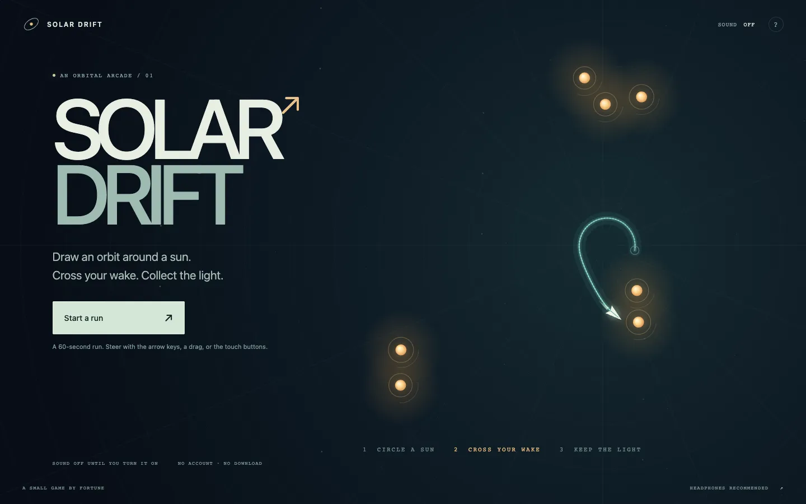
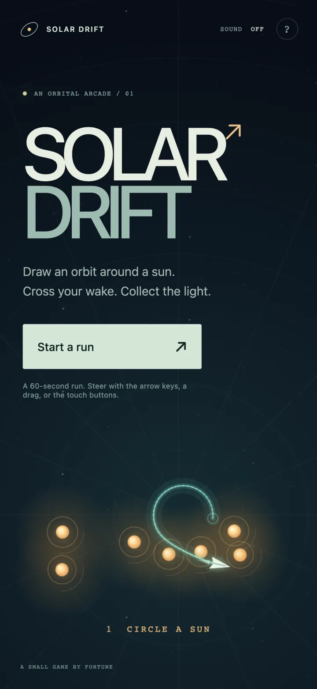
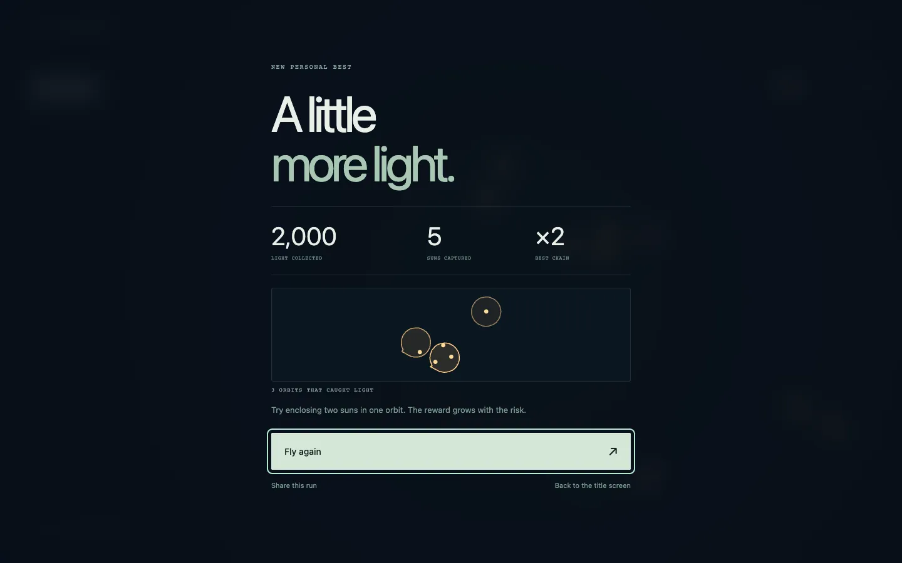

# Solar Drift

**Draw an orbit. Cross your wake. Collect the light.**

**Live demo: [solar-drift-zeta.vercel.app](https://solar-drift-zeta.vercel.app/)** (also on [GitHub Pages](https://fortunexbt.github.io/solar-drift/))



A small orbital arcade game about flying a good circle under pressure. Your ship always moves forward. Loop it around a glowing sun, cross the wake you left behind, and every sun inside the loop is yours. Bigger loops catch more suns and buy more time, and more red bodies drift into the arena as you go.

The title screen teaches the whole thing in about five seconds: a seeded pilot loops a sun, crosses its wake and catches it while a three-step caption follows along. One click or tap on **Start a run** puts you in the same situation.

Canvas 2D, TypeScript and procedural Web Audio. No account, no backend, no network calls during play.

## Your first orbit

Choose **Start a run** to enter the flight area. The ship and clock wait for your first steering input. Hold **←** or the left touch button to curve around the marked sun, then meet your own wake.



Once launched, you always move forward. Your wake lasts **7 seconds**: cross an older part of it to close a loop and capture the suns inside. Surge makes you faster and your turning circle wider.

| What happens | What changes |
| --- | --- |
| Begin a flight | **60 seconds** on the clock, which is where a run starts and not a cap on its length |
| Enclose suns in a loop | Collect light and **+3 seconds per sun**, up to 90 seconds remaining |
| Capture again within 9 seconds | Grow the scoring chain, up to **×4** |
| Close an empty orbit | Clear the loop and reset the chain |
| Hit a red body or the edge | Lose **5 seconds**, your wake, and your chain |
| Pass close to a red body | Recharge your surge |
| Keep collecting | More red bodies enter the arena, up to **six** |

Light per capture is **100 × suns² × chain multiplier**. At ×1, one sun earns 100, two together earn 400, and three together earn 900. The reward is for enclosing them in the **same loop**.

## Controls

| Action | Keyboard | Pointer / touch |
| --- | --- | --- |
| Steer | **← / →** or **A / D** | Hold and drag on the flight area to aim; use **↶ / ↷** on mobile |
| Surge | Hold **Space**, **Shift**, **↑**, or **W** | Hold **Surge** |
| Pause / resume | **Escape** | **Pause**, then **Resume flight** |
| Toggle sound | **M** | **Sound** |
| Read the guide | Tab to **?**, then Enter | Tap **?** |

Sound is off until you turn it on, and the choice is remembered. Headphones suit the quiet motion bed and glass-like capture notes.

## After a run

The result screen shows your light, suns and best chain, plus a map of every loop that caught a sun, with the captured suns marked. **Share this run** opens the system share sheet where there is one (iPhone, Android, Safari) and copies a short line with the link everywhere else. Beating your best on this browser is called out at the top.



## Run locally

Use **Node.js 20.19 or newer**.

```bash
npm ci
npm run dev
```

Open the local URL printed by Vite. To check a change:

```bash
npm run check
```

This runs TypeScript checking, the Vitest suite, and a production build. The suite covers orbital geometry and gameplay rules.

| Command | Purpose |
| --- | --- |
| `npm run typecheck` | Check TypeScript without emitting files |
| `npm test` | Run the test suite once |
| `npm run test:watch` | Run tests while developing |
| `npm run build` | Build the static site into `dist/` |
| `npm run preview` | Serve the production build locally |

## Inside the game

| Source | Responsibility |
| --- | --- |
| [`src/main.ts`](./src/main.ts) | Entry point for the orbital game |
| [`src/orbit/main.ts`](./src/orbit/main.ts) | Flight lifecycle, input, UI updates, sound events, and local preferences |
| [`src/orbit/physics.ts`](./src/orbit/physics.ts) | Movement, wake closure, polygon capture, scoring, charge, hazards, and the title-screen pilot |
| [`src/orbit/render.ts`](./src/orbit/render.ts) | Canvas drawing for the ship, suns, trails, captured orbits, capture sparks, hit shake, and the lesson caption |
| [`src/orbit/audio.ts`](./src/orbit/audio.ts) | Synthesized motion bed and bounded, tuned sound effects |
| [`src/orbit/style.css`](./src/orbit/style.css) · [`index.html`](./index.html) | Responsive interface, controls, guide, and run summaries |
| [`src/orbit/physics.test.ts`](./src/orbit/physics.test.ts) | Geometry and gameplay checks |

The runtime lives in `src/orbit/`. The title-screen demo is the real simulation, not a recording: it runs `OrbitGame` with a seeded random source (`seededRandom`) and steers it with `createAutopilot()`.

## Limits

- A run lasts as long as you keep catching suns: the clock starts at 60 seconds and each sun adds 3, up to 90 on the clock. Difficulty keeps rising with every capture.
- Every run has a seed, shown on the result screen and added to the share link as `?seed=`. The same seed and window size give the same suns and red bodies, so a shared link replays the same sky.
- Scores live in this browser only. There is no online leaderboard, so sharing sends a line of text and a link, not a verifiable score.
- Phones held in landscape at under 500px tall skip the title-screen demo; the game itself still plays.
- With reduced motion turned on, the lesson flight still plays (it is the explanation), but sparks, screen shake and star twinkle are off.

## Data, sound, and credits

The game runs in the browser. It has no account system, analytics, server-side score storage, external font dependency, or runtime service to contact. Browser storage is optional; a run still works when storage is unavailable.

| Local storage key | Saved value |
| --- | --- |
| `solarDriftOrbitBest` | Best orbital-game score on this browser |
| `solarDriftOrbitSound` | Sound preference |

Clearing this site's browser data removes its saved scores and preferences; nothing syncs across devices.

Made by **Fortune**. The game visuals are drawn procedurally, and the audio is synthesized with the Web Audio API. No third-party recordings, samples, or font files are bundled for the orbital game.

Code and original assets are available under the [MIT License](./LICENSE).
